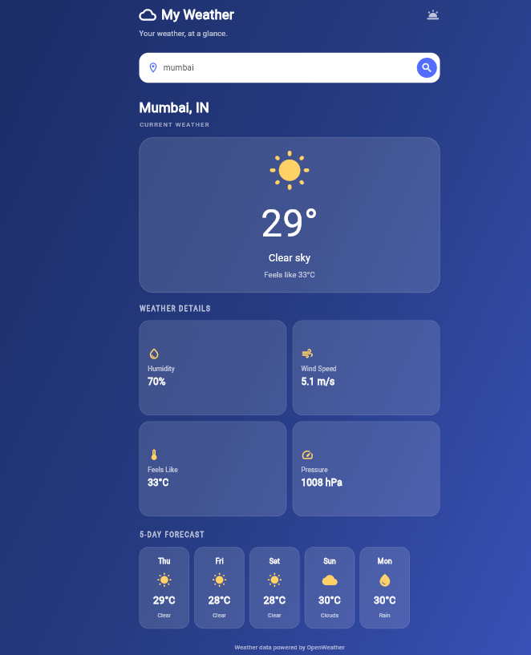

# My Weather 🌦️

My Weather is a weather forecasting application built using Flutter and Dart. It uses the OpenWeather API to display current weather information and a 5-day forecast for a searched city.

## Features
- Search weather by city name
- View current temperature and weather conditions
- Check humidity, wind speed, pressure, and feels-like temperature
- View a 5-day weather forecast
- Simple and user-friendly interface

## Technologies Used
- Flutter
- Dart
- OpenWeather API
- HTTP package

## Getting Started

1. Clone this repository.
2. Open the project folder in VS Code.
3. Install dependencies:

   ```bash
   flutter pub get
   ```

4. Run the app with your OpenWeather API key:

   ```bash
   flutter run -d chrome --dart-define=OPENWEATHER_API_KEY=YOUR_API_KEY
   ```

Replace `YOUR_API_KEY` with your own OpenWeather API key.

## App Screenshot


## Author
Meena Bist
