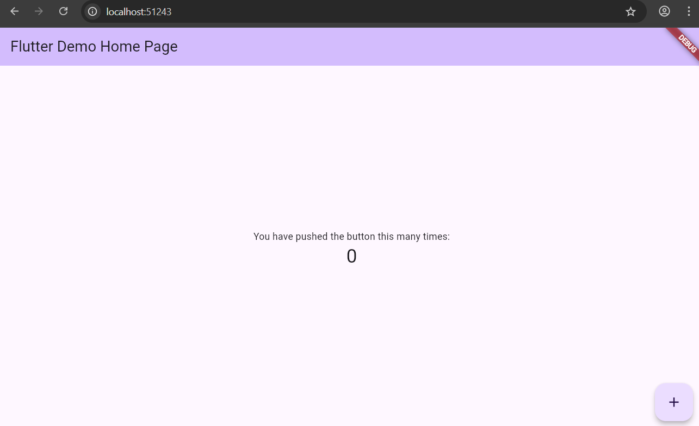

# Flutter Demo App

This is a simple Flutter demo application created to learn the basics of Flutter development and understand how widgets, state management, and UI layout work.

## Features

* Built using Flutter and Dart
* Demonstrates Stateful and Stateless widgets
* Counter functionality example
* Simple Material UI interface

## Tech Stack

* Flutter
* Dart

## App Screenshot



## How to Run the Project

1. Clone the repository
2. Navigate to the project folder
3. Install dependencies

```
flutter pub get
```

4. Run the application

```
flutter run
```

## Author

Hiteshi Dhandare
